# NEXO · Dos propuestas de solución

**TP3 · Desarrollo de Sistemas Web (Front End) · 2026**  
**IFTS 29 · Tecnicatura Superior en Desarrollo de Software · 2.º A**  
**Grupo 12 · EXIMIA CODE · Bloque S11-A — Solicitud y opciones**

Landing desarrollada para presentar dos propuestas conceptuales de automatización destinadas a **NEXO**, startup creada por estudiantes del IFTS 16. La página organiza las sentencias asignadas, explica las decisiones de diseño del equipo y permite recorrer los dos flujos mediante diagramas SVG interactivos.

> **Alcance del proyecto:** la landing presenta y simula visualmente dos propuestas. No incorpora IA en ejecución, no conecta APIs, no utiliza backend y no ejecuta agentes ni automatizaciones reales. La IA se utilizó como herramienta de construcción del sitio.

## Índice

- [Descripción y objetivo](#descripción-y-objetivo)
  - [Datos institucionales](#datos-institucionales)
- [Sitio publicado y repositorio](#sitio-publicado-y-repositorio)
- [Integrantes y perfiles](#integrantes-y-perfiles)
- [Organización y responsabilidades](#organización-y-responsabilidades)
- [Startup y sentencias asignadas](#startup-y-sentencias-asignadas)
  - [NEXO](#nexo)
  - [Bloque S11-A · Solicitud y opciones](#bloque-s11-a--solicitud-y-opciones)
- [Propuestas y lógica de los flujos](#propuestas-y-lógica-de-los-flujos)
  - [R1 · Encontrá al profesional adecuado](#r1--encontrá-al-profesional-adecuado)
  - [R2 · Profesionales listos para ayudarte](#r2--profesionales-listos-para-ayudarte)
- [Organización técnica y tecnologías](#organización-técnica-y-tecnologías)
  - [Estructura del proyecto](#estructura-del-proyecto)
  - [Responsabilidad de los archivos JavaScript](#responsabilidad-de-los-archivos-javascript)
  - [Identidad visual](#identidad-visual)
  - [Identidad cromática](#identidad-cromática)
- [Instalación y reproducción](#instalación-y-reproducción)
- [Interacciones y funcionamiento](#interacciones-y-funcionamiento)
  - [Interacciones de R1](#interacciones-de-r1)
  - [Interacciones de R2](#interacciones-de-r2)
- [Pruebas y verificación](#pruebas-y-verificación)
  - [Casos de prueba de R1](#casos-de-prueba-de-r1)
  - [Casos de prueba de R2](#casos-de-prueba-de-r2)
- [Accesibilidad y diseño responsive](#accesibilidad-y-diseño-responsive)
  - [Contraste de colores](#contraste-de-colores)
- [Limitaciones conocidas](#limitaciones-conocidas)
- [Capturas de la entrega](#capturas-de-la-entrega)
  - [1. Interfaz de la landing](#1-interfaz-de-la-landing)
  - [2. Proceso de trabajo con IA](#2-proceso-de-trabajo-con-ia)
- [Uso de inteligencia artificial](#uso-de-inteligencia-artificial)
  - [Uso y supervisión humana](#uso-y-supervisión-humana)
- [Bitácora de iteraciones con IA](#bitácora-de-iteraciones-con-ia)
- [Colaboración, revisión cruzada y Pull Requests](#colaboración-revisión-cruzada-y-pull-requests)
  - [Mejoras concretas surgidas de las revisiones](#mejoras-concretas-surgidas-de-las-revisiones)
- [Checklist de verificación](#checklist-de-verificación)
  - [Consigna: contenido y lógica](#consigna-contenido-y-lógica)
  - [Consigna: diseño y funcionamiento](#consigna-diseño-y-funcionamiento)
  - [Entrega y documentación](#entrega-y-documentación)
- [Relación con la rúbrica — nivel PROPONE](#relación-con-la-rúbrica--nivel-propone)

---

## Descripción y objetivo

**NEXO** ofrece servicios y reparaciones, conectando clientes con profesionales según el tipo de servicio, la ubicación y la disponibilidad. El Grupo 12, **EXIMIA CODE**, recibió el bloque **S11-A · Solicitud y opciones** y desarrolló una propuesta para cada una de las dos sentencias asignadas.

La landing contiene:

- Presentación de NEXO y del equipo EXIMIA CODE, conservando sus logotipos originales como recursos separados.
- Identificación institucional, startup destinataria y bloque asignado.
- Las dos sentencias originales, reproducidas literalmente.
- Dos propuestas conceptuales, una para R1 y otra para R2.
- Diagramas SVG interactivos con decisiones, ramas Sí/No, acciones, resultados y controles para iniciar, avanzar, retroceder y reiniciar.
- Desplegables con explicaciones, casos límite, excepciones, decisiones de diseño y participación humana.
- Leyendas para interpretar los símbolos y colores de los diagramas.
- Recorrido vertical para pantallas angostas y posibilidad de consultar el diagrama completo.
- Información del equipo, responsabilidades, herramientas de IA, iteraciones y verificaciones.

La propuesta distingue en todo momento las condiciones que pertenecen a las sentencias originales de los pasos adicionales definidos por el grupo. Las decisiones agregadas —por ejemplo, solicitar datos faltantes o derivar un caso a revisión humana— se identifican como **decisiones de diseño del grupo**, no como requisitos textuales de NEXO.

### Datos institucionales

| Dato | Información |
|---|---|
| Institución | IFTS 29 |
| Carrera | Tecnicatura Superior en Desarrollo de Software |
| Asignatura | Desarrollo de Sistemas Web (Front End) |
| Curso | 2.º A |
| Docente | Luciano Martínez |
| Período | Segundo cuatrimestre de 2026 |
| Entrega | 26/11/2026 |
| Grupo | 12 |
| Equipo desarrollador | EXIMIA CODE |
| Startup destinataria | NEXO |
| Bloque asignado | S11-A · Solicitud y opciones |
| Origen de NEXO | Estudiantes del IFTS 16 |

## Sitio publicado y repositorio

- **Landing en Vercel:** https://tp3-grupo-12.vercel.app/
- **Repositorio GitHub:** https://github.com/fiorellaalarcon/tp3-grupo12

Ambos enlaces corresponden a la entrega del Grupo 12. El sitio publicado y el repositorio se comprobaron sin iniciar sesión el **25/11/2026**. La landing puede recorrerse desde un navegador moderno.

## Integrantes y perfiles

| Integrante | Perfil de GitHub |
|---|---|
| Fiorella Alarcón | [@fiorellaalarcon](https://github.com/fiorellaalarcon) |
| Axel Alva | [@axelalva2023](https://github.com/axelalva2023) |
| Javier Churquina | [@Freddy1537](https://github.com/Freddy1537) |
| Malena Jasque | [@malenajasque](https://github.com/malenajasque) |
| Selene Pais | [@Selepais](https://github.com/Selepais) |

## Organización y responsabilidades

La distribución del trabajo combinó responsabilidades principales con instancias de revisión cruzada. Los aportes se reconstruyen a partir de los roles acordados por el equipo, los cambios incorporados al proyecto y las revisiones registradas en los Pull Requests.

| Integrante | Responsabilidad | Trabajo realizado | Aspectos revisados | Aporte al resultado |
|---|---|---|---|---|
| **Alarcón, Fiorella** | Coordinación general, integración y publicación en Vercel. | Coordinó el desarrollo, incorporó la estructura base (PR #1) y, dirigiendo a Codex, la sección Equipo y la ficha técnica de construcción agéntica (PR #5). También gestionó la publicación de la landing. | Revisó el PR #4 de Malena: leyendas, contraste, recorridos R1 y R2, navegación por teclado y visualización en 1440, 768 y 390 px. | Su revisión comprobó la alternancia entre vista vertical y SVG completo, los recorridos y la navegación, y autorizó la integración del PR #4 en `main`. |
| **Alva, Axel** | Análisis, desarrollo y pruebas de R1. | Desarrolló las decisiones de diseño y los casos de prueba correspondientes a R1 (PR #2). | Revisó el PR #3 de Javier, especialmente las cuatro condiciones de R2, los puntos de unión y los casos de prueba. | Observó que los puntos de unión debían mostrar con claridad la continuidad del recorrido, sin superposición de flechas, y que debía contemplarse el caso de datos dudosos con intervención humana antes de reevaluar; verificó que la regla de elegibilidad se conservara. |
| **Churquina, Javier** | Análisis, desarrollo y pruebas de R2. | Desarrolló el flujo R2 y sus casos de prueba (PR #3). Su identificación en GitHub fue informada por el equipo como `@Freddy1537`. | Revisó el PR #2 de Axel, los casos R1 de datos faltantes y ausencia de coincidencias, y su diferenciación respecto de la sentencia original. | La revisión permitió confirmar que los supuestos agregados estuvieran identificados y que R1 no incorporara condiciones de disponibilidad ni verificación. |
| **Jasque, Malena** | UX/UI, diseño responsive y accesibilidad. | Desarrolló las mejoras de visualización, legibilidad y accesibilidad de los diagramas (PR #4). | Revisó el PR #5 de Fiorella, correspondiente a Equipo y ficha técnica, y el PR #6 de Selene, correspondiente al README, las capturas, las evidencias y los enlaces. | Verificó la correspondencia entre integrantes, imágenes, roles y responsabilidades, así como la coherencia entre la documentación, las capturas y los enlaces de entrega. |
| **Pais, Selene** | Documentación y evidencias. | Preparó y actualizó el README, las capturas, los enlaces y la bitácora del proyecto (PR #6). | Revisó el PR #1 de Fiorella, particularmente la estructura inicial, la organización de archivos y las rutas de los recursos. | Su revisión permitió comprobar la organización de la estructura y la disponibilidad de los recursos antes de integrar la base sobre la que se desarrollaron R1 y R2. |

## Startup y sentencias asignadas

### NEXO

NEXO es una startup de servicios y reparaciones que conecta a clientes con profesionales según el servicio solicitado, la ubicación y la disponibilidad. Fue creada por estudiantes del IFTS 16. El Grupo 12, perteneciente al IFTS 29, desarrolló las propuestas a partir de las sentencias asignadas, reconociendo el origen de la startup y manteniendo su identidad visual original.

### Bloque S11-A · Solicitud y opciones

Se conservaron literalmente las dos sentencias recibidas.

**R1**

> Si el cliente indica el tipo de servicio y su ubicación, el sistema busca profesionales que cubran esa necesidad y zona.

**R2**

> Si un profesional coincide con el servicio y la zona, tiene disponibilidad y está verificado, el sistema lo muestra como opción al cliente.

## Propuestas y lógica de los flujos

### R1 · Encontrá al profesional adecuado

**Entradas:** tipo de servicio y ubicación del cliente.

**Condición de la sentencia:** el cliente indica ambos datos.

**Consecuencia establecida:** el sistema busca profesionales que cubran la necesidad y la zona.

La propuesta describe un futuro agente de NEXO que recibe el servicio y la ubicación, comprueba si cuenta con ambos datos y consulta conceptualmente un registro de profesionales, servicios y zonas.

- Si falta el tipo de servicio o la ubicación, solicita al cliente que complete la información. La solicitud de datos faltantes es una **decisión de diseño del grupo**.
- Si existen profesionales que cubren la necesidad y la zona, presenta los resultados.
- Si la búsqueda no encuentra profesionales que cubran esa necesidad y zona, deriva el caso a revisión humana para definir e informar el siguiente paso. La derivación y la intervención humana son **decisiones de diseño del grupo**.

R1 no incorpora disponibilidad ni verificación como condiciones, porque esos requisitos pertenecen a R2 y no aparecen en la sentencia R1.

El diagrama permite recorrer los tres escenarios: información incompleta, búsqueda con coincidencias y búsqueda sin coincidencias. Cada recorrido tiene una salida identificable.

### R2 · Profesionales listos para ayudarte

**Condiciones evaluadas:**

1. Coincidencia con el servicio solicitado.
2. Coincidencia con la zona.
3. Disponibilidad del profesional.
4. Verificación del profesional.

La lógica se expresa como una conjunción:

**servicio ∧ zona ∧ disponibilidad ∧ verificación**

El futuro agente evalúa las cuatro condiciones. Solo cuando las cuatro respuestas son afirmativas presenta al profesional como opción. Si una o más condiciones son negativas, el profesional no se muestra como opción elegible.

La propuesta incorpora además una comprobación previa para detectar datos ausentes, desactualizados o dudosos. En ese caso solicita una actualización y deriva la información a revisión humana. Una persona confirma o corrige los datos y, luego, el flujo vuelve a evaluar las condiciones. La actualización, la revisión humana y la reevaluación son **decisiones de diseño del grupo**; no modifican la conjunción establecida por la sentencia.

El diagrama y su tabla de casos dejan explícitos los resultados:

- Cuatro respuestas **Sí**: el profesional es elegible y se muestra como opción.
- Una o más respuestas **No**: el profesional no es elegible.
- Datos dudosos o desactualizados: actualización, revisión humana y nueva evaluación después de la confirmación o corrección.

## Organización técnica y tecnologías

La landing se desarrolló con tecnologías web nativas, sin framework y sin dependencias de compilación.

| Tecnología o recurso | Uso en el proyecto |
|---|---|
| **HTML5** | Estructura semántica, navegación, contenido, botones y elementos desplegables. |
| **CSS3** | Identidad visual, tokens, composición, componentes, diagramas, accesibilidad y responsive. |
| **JavaScript** | Navegación y control de los recorridos interactivos R1 y R2. |
| **SVG** | Diagramas, nodos, conectores, etiquetas y resaltado de los pasos activos. |
| **Google Fonts** | Tipografías Orbitron, Space Grotesk e IBM Plex Sans, con alternativas del sistema. |
| **WebP** | Logotipos originales de NEXO y EXIMIA CODE y retratos del equipo. |

### Estructura del proyecto

```text
tp3-grupo12/
├── assets/
│   └── img/
│       ├── axel-400.webp
│       ├── eximia-code.webp
│       ├── fiorella-400.webp
│       ├── javier-400.webp
│       ├── malena-400.webp
│       ├── nexo-s11.webp
│       └── selene-400.webp
├── css/
│   ├── accessibility.css
│   ├── base.css
│   ├── components.css
│   ├── diagrams.css
│   ├── layout.css
│   ├── responsive.css
│   └── tokens.css
├── docs/
│   ├── IA-PROMPTS.md
│   └── capturas/
│       ├── interfaz/
│       │   ├── 01-portada-nexo.jpeg
│       │   ├── 02-equipo-ficha-tecnica.jpeg
│       │   ├── 03-diagrama-r1-desktop.jpeg
│       │   ├── 04-diagrama-r2-desktop.jpeg
│       │   ├── 05-excepciones-r1.png
│       │   └── 06-vista-responsive-r1.png
│       └── proceso/
│           ├── 01-codex-modelo-gpt-6-luna.png
│           ├── 02-fiorella-analisis.png
│           ├── 03-fiorella-estructura.png
│           ├── 04-fiorella-equipo.png
│           ├── 05-axel-r1.png
│           ├── 06-javier-r2.png
│           ├── 07-malena-responsive.png
│           └── 08-selene-documentacion.png
├── index.html
├── js/
│   ├── flow-controller.js
│   ├── flow-data.js
│   ├── flow-mobile-map.js
│   ├── flow-r2-controller.js
│   └── main.js
└── README.md
```

### Responsabilidad de los archivos JavaScript

- **`main.js`:** inicialización y comportamiento general de la landing.
- **`flow-data.js`:** datos y estructura de los pasos del flujo R1.
- **`flow-controller.js`:** control de navegación, selección y resaltado del recorrido R1.
- **`flow-r2-controller.js`:** control de decisiones y recorrido interactivo R2.
- **`flow-mobile-map.js`:** presentación del recorrido vertical y alternancia con el diagrama SVG completo en pantallas angostas.

Los estilos se separan por responsabilidad: tokens visuales, base, layout, componentes, diagramas, accesibilidad y responsive.

### Identidad visual

Los logotipos originales se conservan como recursos independientes:

- `assets/img/nexo-s11.webp`: identidad de la startup NEXO, protagonista de la presentación.
- `assets/img/eximia-code.webp`: identidad del equipo desarrollador EXIMIA CODE.

No se reemplazaron por marcas inventadas ni se fusionaron en un único archivo.

### Identidad cromática

La referencia cromática principal se tomó del logo original de NEXO: fondo azul marino, símbolo en tonos azules y verdes brillantes y lettering blanco. La interfaz traduce esa identidad a la siguiente paleta:

| Color | Código | Uso |
|---|---|---|
| Fondo claro | `#F4F7FB` y `#FFFFFF` | Fondos de la interfaz. |
| Azul marino | `#06264A` | Algunos títulos y elementos de identidad. |
| Azul de acción | `#0876D1` | Enlaces y controles. |
| Texto principal | `#102A43` | Texto y encabezados generales. |
| Texto secundario | `#42566E` | Texto de apoyo. |
| Azul eléctrico | `#0078E8` | Acento retomado de la identidad de EXIMIA CODE; detalles gráficos. |
| Verde eléctrico | `#00E85B` | Acento retomado de la identidad de EXIMIA CODE; detalles gráficos. |
| Verde | `#087A45` | Estado funcional en los diagramas. |
| Ámbar | `#7A4B00` | Estado funcional en los diagramas. |
| Rojo | `#A42318` | Estado funcional en los diagramas. |

Los acentos eléctricos no se utilizan indiscriminadamente en texto pequeño. Los colores de estado de los diagramas se distinguen de los acentos de marca y se acompañan con rótulos para que el significado no dependa solo del color. Así se mantiene la continuidad visual del equipo sin quitar protagonismo a NEXO ni modificar los logotipos originales.

## Instalación y reproducción

No se requiere instalar dependencias, ejecutar un proceso de compilación ni configurar un backend. Es suficiente un navegador moderno.

1. Clonar o descargar el repositorio:
   ```bash
   git clone https://github.com/fiorellaalarcon/tp3-grupo12.git
   ```
2. Ingresar en la carpeta del proyecto:
   ```bash
   cd tp3-grupo12
   ```
3. Abrir `index.html` en un navegador moderno.

También puede iniciarse un servidor local desde la carpeta raíz:

```bash
python -m http.server 8000
```

En Windows:

```bash
py -m http.server 8000
```

Luego abrir `http://localhost:8000`. Para detener el servidor, volver a la terminal y presionar `Ctrl+C`.

Las tipografías de Google Fonts requieren conexión a Internet. Si no están disponibles, se utilizan las alternativas tipográficas declaradas en CSS.

## Interacciones y funcionamiento

Los diagramas permiten iniciar, seleccionar alternativas, avanzar, retroceder y reiniciar el recorrido. El estado activo se refleja en el diagrama para que el usuario pueda reconocer qué paso está recorriendo.

### Interacciones de R1

- Iniciar el recorrido.
- Comprobar si están presentes el servicio y la ubicación.
- Recorrer la rama de datos faltantes y finalizar en espera de la información.
- Recorrer la búsqueda con coincidencias y visualizar los resultados.
- Recorrer la búsqueda sin coincidencias y llegar a la instancia de revisión humana.

### Interacciones de R2

- Iniciar el recorrido y comprobar si existen datos dudosos.
- Recorrer la actualización y revisión humana cuando corresponde.
- Evaluar las cuatro condiciones de elegibilidad.
- Comprobar que únicamente cuatro respuestas Sí permiten mostrar al profesional como opción.
- Comprobar que una o más respuestas No impiden considerarlo elegible.
- Volver al paso anterior o reiniciar el recorrido.

Los desplegables amplían la explicación de las excepciones, los casos límite, las decisiones agregadas y la intervención humana. Utilizan elementos HTML nativos `<details>` y `<summary>`.

## Pruebas y verificación

El equipo realizó, el **25/11/2026**, una revisión funcional, visual y de accesibilidad sobre la versión integrada y publicada, con las cuatro integraciones de `main` anteriores al README. Las verificaciones de cada Pull Request quedaron además registradas como comentarios de revisión en GitHub. Se comprobaron los recorridos, las combinaciones de decisión, los controles, la navegación por teclado y la presentación en distintos anchos de pantalla.

| Área | Verificación realizada | Resultado |
|---|---|---|
| **Repositorio y publicación** | Apertura del repositorio y de la landing desde una ventana sin sesión. | Ambos enlaces públicos accesibles. |
| **Carga general** | Revisión de portada, logotipos, estilos, scripts y recursos locales. | Recursos cargados correctamente. |
| **Sentencias** | Comparación del texto de R1 y R2 con las sentencias asignadas. | Redacción conservada literalmente. |
| **R1 · datos incompletos** | Recorrido con servicio o ubicación faltante. | Solicita completar los datos y finaliza en espera. |
| **R1 · coincidencias** | Recorrido con servicio y ubicación completos y profesionales disponibles en el registro conceptual. | Presenta resultados. |
| **R1 · sin coincidencias** | Recorrido con datos completos y ausencia de profesionales que cubran la necesidad y zona. | Deriva a revisión humana y comunica el siguiente paso. |
| **R2 · combinaciones** | Prueba de las 16 combinaciones posibles de cuatro condiciones binarias. | Solo cuatro respuestas Sí producen elegibilidad; las otras 15 combinaciones no presentan al profesional como opción elegible. |
| **R2 · datos dudosos** | Recorrido de actualización, confirmación/corrección humana y reevaluación. | Retorna a la evaluación de las cuatro condiciones. |
| **Controles** | Inicio, selección, avance, retroceso y reinicio en ambos diagramas. | Responden correctamente y reflejan el paso activo. |
| **Navegación por teclado** | Recorrido con Tab, Enter y Espacio, foco visible y activación de controles. | Controles operables mediante teclado y foco identificable. |
| **Vistas responsive** | Revisión a 1440 px, 768 px y 390 px, y comprobación posterior del diagrama completo a 390, 360, 600 y 768 px. | Se adapta la presentación; en pantallas angostas se ofrece el recorrido vertical y la alternancia con el diagrama completo, que se desplaza horizontalmente dentro de su sección sin desbordar la página. |
| **Alternancia de diagramas** | Cambio entre recorrido vertical y SVG completo en R1 y R2. | Los controles funcionan de manera independiente y actualizan `aria-expanded`. |
| **Contraste y lectura** | Revisión de textos, estados, leyendas, nodos y botones. | Contraste y estados textuales revisados; el significado no depende exclusivamente del color. |
| **Consola** | Revisión durante los recorridos de prueba. | Sin errores JavaScript observados durante las pruebas realizadas. |

### Casos de prueba de R1

| Escenario | Datos | Resultado esperado |
|---|---|---|
| Información incompleta | Falta servicio o ubicación. | Solicitar el dato faltante y dejar el flujo en espera. |
| Búsqueda con coincidencias | Servicio y ubicación completos; hay profesionales que cubren ambos. | Mostrar resultados. |
| Búsqueda sin coincidencias | Servicio y ubicación completos; no hay profesionales que cubran ambos. | Derivar a revisión humana e informar el siguiente paso. |

### Casos de prueba de R2

La evaluación contempla las 16 combinaciones de cuatro condiciones binarias.

| Servicio | Zona | Disponibilidad | Verificación | Resultado |
|---|---|---|---|---|
| Sí | Sí | Sí | Sí | **Elegible**: se muestra como opción. |
| Sí | Sí | Sí | No | No elegible: falta la verificación. |
| Sí | Sí | No | Sí | No elegible: no tiene disponibilidad. |
| Sí | No | Sí | Sí | No elegible: no cubre la zona. |
| No | Sí | Sí | Sí | No elegible: no coincide con el servicio. |
| *Las otras 11 combinaciones* | | | | No elegible: no se muestra como opción. |

Además, se probó el escenario de datos ausentes, desactualizados o dudosos: actualización solicitada, revisión humana, confirmación o corrección y retorno a la evaluación.

## Accesibilidad y diseño responsive

Se incorporaron recursos para facilitar la lectura y el uso de la landing:

- Estructura semántica y jerarquía de encabezados.
- Controles HTML operables mediante teclado.
- Indicador de foco visible.
- Estados y resultados expresados mediante texto, además de color.
- Leyendas para reconocer pasos, decisiones y ramas de los diagramas.
- Desplegables nativos mediante `<details>` y `<summary>`.
- Atributos de estado como `aria-expanded` en los controles de alternancia.
- Adaptación del recorrido de los diagramas para pantallas angostas.
- Respeto por la preferencia de movimiento reducido mediante `prefers-reduced-motion`.

En desktop se presenta el diagrama SVG completo. En pantallas de hasta 768 px se ofrece un recorrido vertical y controles para alternar con la vista completa. La alternancia de R1 y R2 es independiente.

### Contraste de colores

Ratios calculados con la fórmula de luminancia relativa WCAG a partir de los colores de `css/tokens.css`. Los pares principales superan 4,5:1 para texto normal.

| Texto o indicador | Fondo | Ratio | Resultado AA |
|---|---|---:|---|
| `#102A43` | Blanco `#FFFFFF` | 14,64:1 | Cumple |
| `#102A43` | Azul muy claro `#EAF3FB` | 13,05:1 | Cumple |
| `#42566E` | Blanco `#FFFFFF` | 7,53:1 | Cumple |
| Blanco `#FFFFFF` | Botón azul `#0876D1` | 4,64:1 | Cumple |
| Blanco `#FFFFFF` | Azul de foco `#005FCC` | 5,98:1 | Cumple |
| `#087A45` | Verde claro `#E8F7EF` | 4,89:1 | Cumple |
| `#7A4B00` | Ámbar claro `#FFF4D6` | 6,76:1 | Cumple |
| `#A42318` | Rojo claro `#FDECEC` | 6,49:1 | Cumple |

## Limitaciones conocidas

- La consigna evalúa la lectura en desktop; las vistas de pantalla angosta son un recurso adicional.
- Los pares de contraste verificados son los principales de los tokens, no cada píxel del sitio.

## Capturas de la entrega

Las capturas están en `docs/capturas/`, separadas en `interfaz/` (producto en desktop) y `proceso/` (trabajo con IA). Están en formato PNG y JPEG. Cada una documenta una parte concreta del producto o del proceso y se relaciona con el criterio de la rúbrica que respalda.

### 1. Interfaz de la landing

#### 1.1. Portada y presentación de NEXO

**Archivo:** `docs/capturas/interfaz/01-portada-nexo.jpeg`

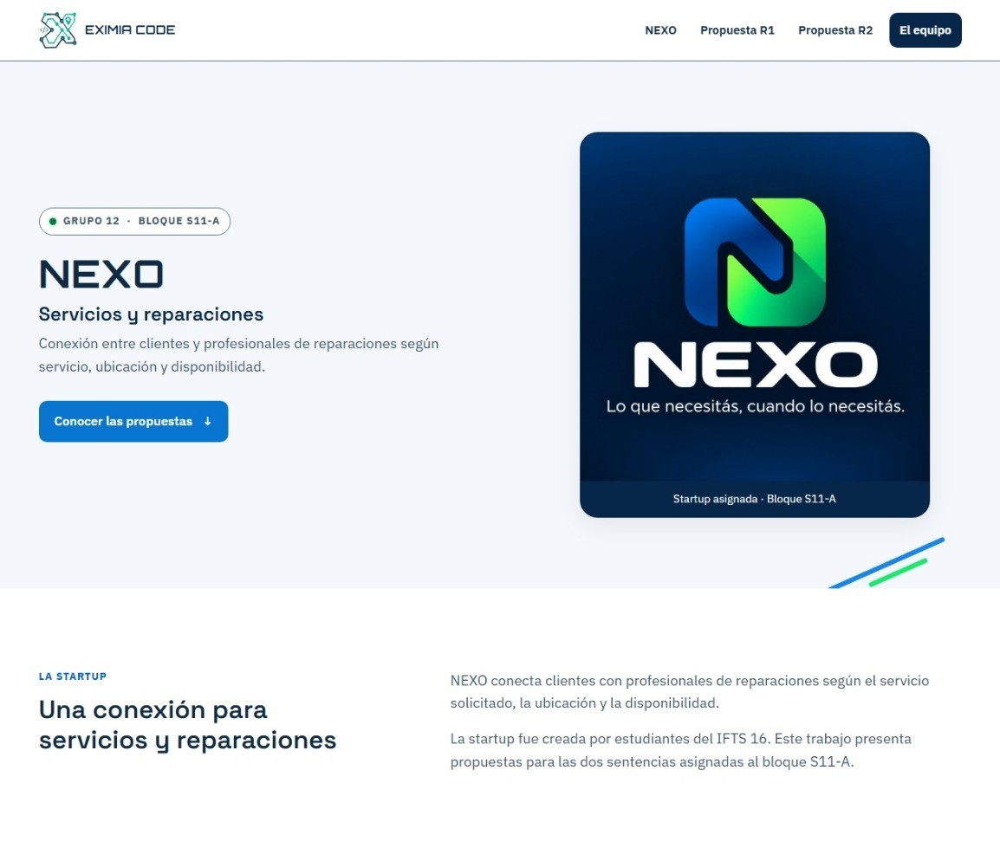

**Descripción:** portada de la landing en desktop. Muestra la identidad original de NEXO, la identificación del equipo EXIMIA CODE, el contexto del TP3 y el acceso a las dos propuestas. Es evidencia de la presentación de la startup con su logo original y de la organización de los contenidos (criterio 3).

#### 1.2. Equipo y ficha técnica

**Archivo:** `docs/capturas/interfaz/02-equipo-ficha-tecnica.jpeg`

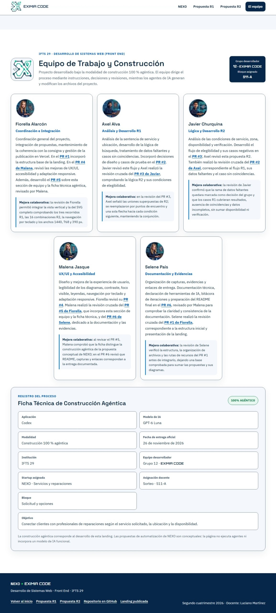

**Descripción:** sección Equipo con la identidad de EXIMIA CODE, los cinco integrantes con su retrato, responsabilidad y enlaces a sus Pull Requests, y la ficha técnica de construcción agéntica. Es evidencia de la participación de todos los integrantes y de que el equipo desarrollador se distingue de la startup destinataria (criterios 1 y 3). También se ve el pie de página.

#### 1.3. Diagrama completo de R1

**Archivo:** `docs/capturas/interfaz/03-diagrama-r1-desktop.jpeg`

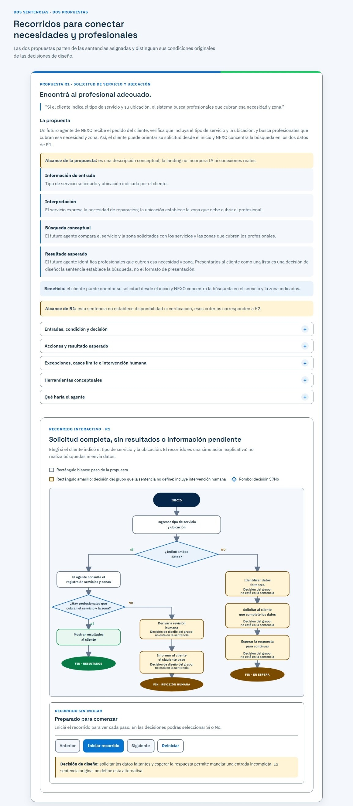

**Descripción:** diagrama R1 en vista desktop, con sus nodos, decisiones, ramas, conectores, resultados y leyenda. Permite comprobar la legibilidad del flujo y distinguir la búsqueda indicada por la sentencia de las decisiones agregadas por el grupo. Aporta evidencia de la propuesta para la primera sentencia y de sus casos límite (criterio 4).

#### 1.4. Diagrama completo de R2

**Archivo:** `docs/capturas/interfaz/04-diagrama-r2-desktop.jpeg`

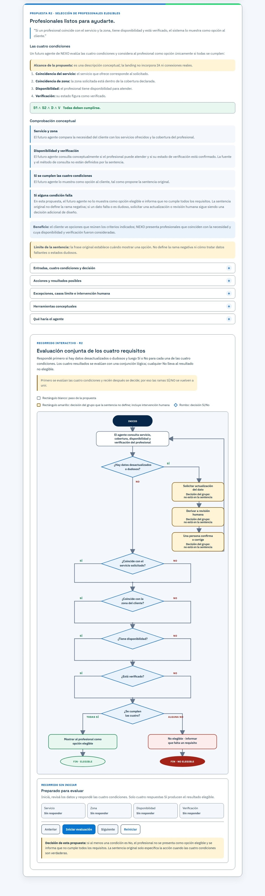

**Descripción:** diagrama R2 en vista desktop. Muestra la evaluación de servicio, zona, disponibilidad y verificación, los puntos de unión y el resultado de elegibilidad. Permite comprobar que las cuatro condiciones deben ser afirmativas y que una o más respuestas negativas impiden mostrar al profesional como opción (criterio 4).

#### 1.5. Desplegable de excepciones de R1

**Archivo:** `docs/capturas/interfaz/05-excepciones-r1.png`

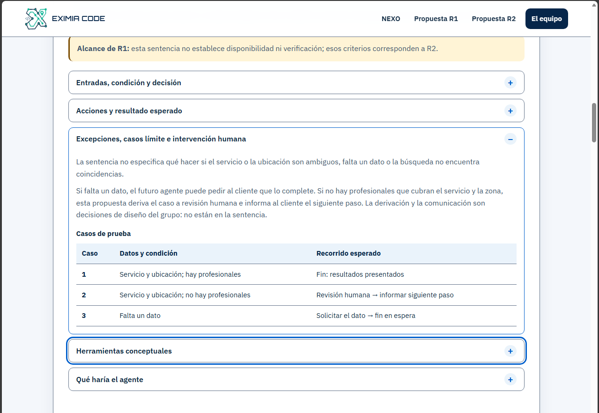

**Descripción:** desplegable abierto con la explicación de excepciones, casos límite, decisiones de diseño e intervención humana, y la tabla de casos de prueba de R1. Es evidencia de que la landing no se limita a mostrar diagramas: también explica cómo se resuelven los casos especiales y qué decisiones agregó el equipo (criterio 4, nivel Propone). Se ve el foco visible durante la prueba con teclado, que permite abrir y cerrar el desplegable con Enter.

#### 1.6. Vista responsive de R1

**Archivo:** `docs/capturas/interfaz/06-vista-responsive-r1.png`

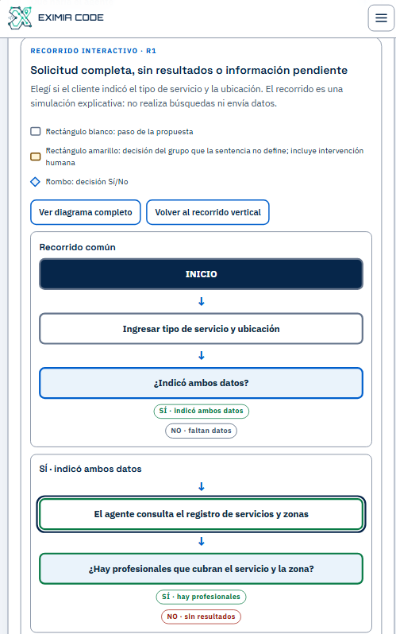

**Descripción:** vista de R1 en pantalla angosta, con el recorrido vertical y los controles para alternar con el diagrama SVG completo. Es evidencia del recurso adicional de navegación y explicación (criterio 3, nivel Propone).

### 2. Proceso de trabajo con IA

Cada captura muestra una interacción real con la instrucción dada a Codex, la respuesta del agente y los archivos que modificó. En la parte inferior se ve el selector de modelo de la aplicación.

#### 2.1. Codex y modelo utilizado

**Archivo:** `docs/capturas/proceso/01-codex-modelo-gpt-6-luna.png`

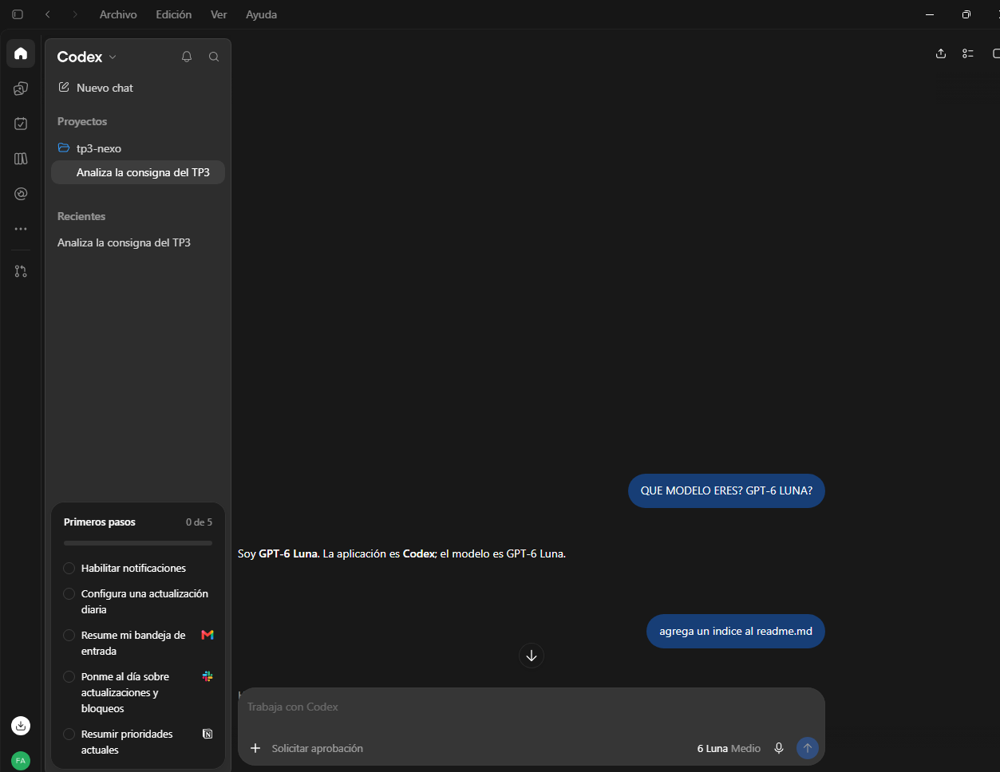

**Descripción:** captura de la aplicación **Codex**. En el selector inferior figura el modelo **GPT-6 Luna** con nivel de razonamiento **Medio**. Distingue la aplicación del modelo y respalda la declaración de herramientas de este README (criterio 5).

#### 2.2. Fiorella Alarcón · coordinación, análisis e integración

**Archivos:** `docs/capturas/proceso/02-fiorella-analisis.png` · `docs/capturas/proceso/03-fiorella-estructura.png` · `docs/capturas/proceso/04-fiorella-equipo.png`

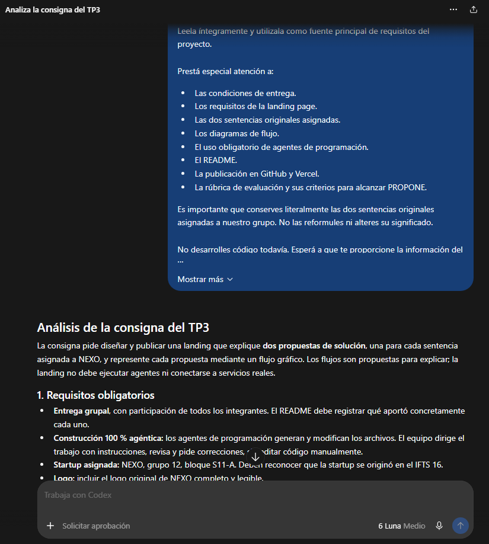

**a. Análisis y planificación.** Interacción con IA para interpretar la consigna, identificar los requerimientos y organizar las etapas de desarrollo de NEXO.

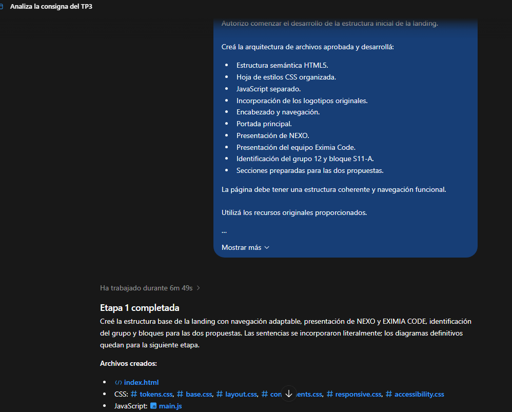

**b. Estructura e integración.** Interacción orientada a definir la estructura de la landing, sus secciones y componentes, y a integrar los aportes del equipo en una solución coherente.

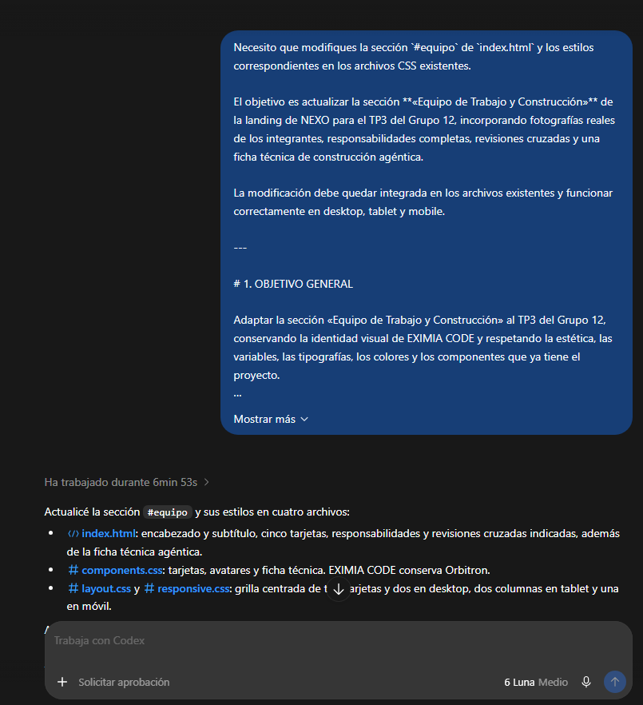

**c. Equipo y ficha técnica.** Interacción para incorporar la sección Equipo, con retratos, roles y responsabilidades de los cinco integrantes, y la ficha técnica de construcción agéntica.

#### 2.3. Axel Alva · propuesta R1

**Archivo:** `docs/capturas/proceso/05-axel-r1.png`

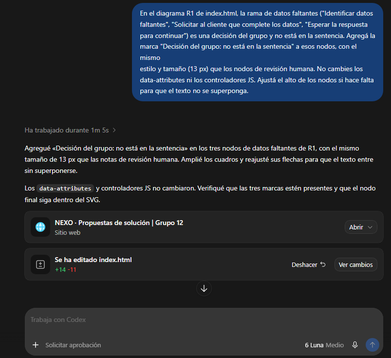

**Descripción:** instrucción para marcar como «Decisión del grupo: no está en la sentencia» los tres nodos de la rama de datos faltantes de R1. El agente agregó la marca con el tamaño de 13 px, amplió los cuadros y reajustó las flechas sin cambiar los `data-attributes` ni los controladores (`index.html`, +14 −11).

#### 2.4. Javier Churquina · propuesta R2

**Archivo:** `docs/capturas/proceso/06-javier-r2.png`

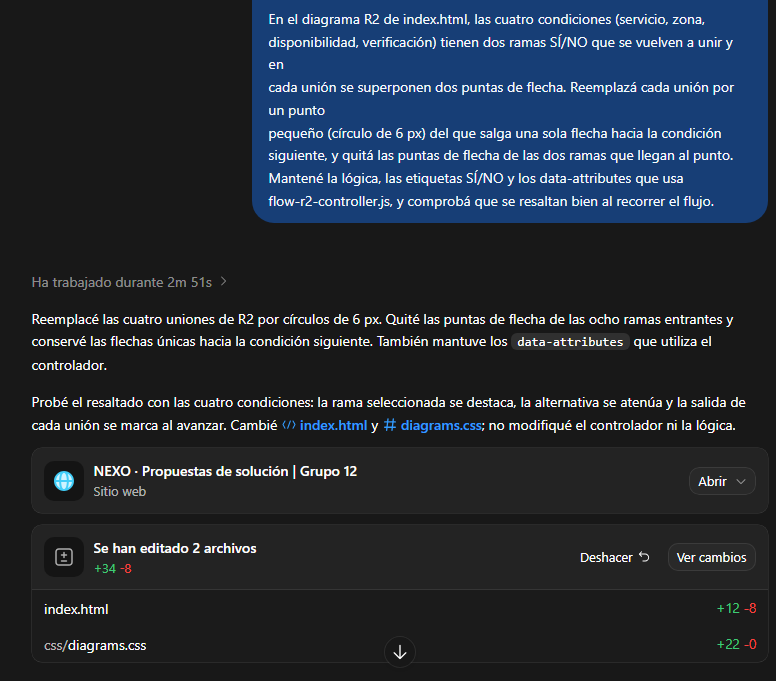

**Descripción:** instrucción para reemplazar las cuatro uniones superpuestas de R2 por puntos de 6 px con una sola flecha de salida. El agente quitó las puntas de las ocho ramas entrantes, conservó los `data-attributes` y comprobó el resaltado (`index.html` y `css/diagrams.css`, +34 −8).

#### 2.5. Malena Jasque · UX/UI y accesibilidad

**Archivo:** `docs/capturas/proceso/07-malena-responsive.png`

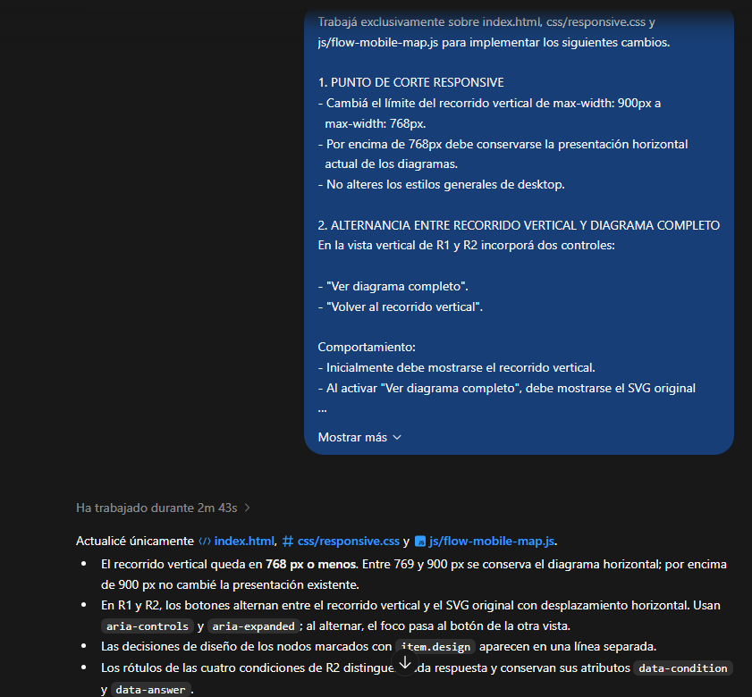

**Descripción:** mejora de la experiencia de usuario mediante ajustes de diseño responsive, accesibilidad y navegación, con el proceso de refinamiento de la interfaz en distintos anchos de pantalla.

#### 2.6. Selene Pais · documentación y evidencias

**Archivo:** `docs/capturas/proceso/08-selene-documentacion.png`

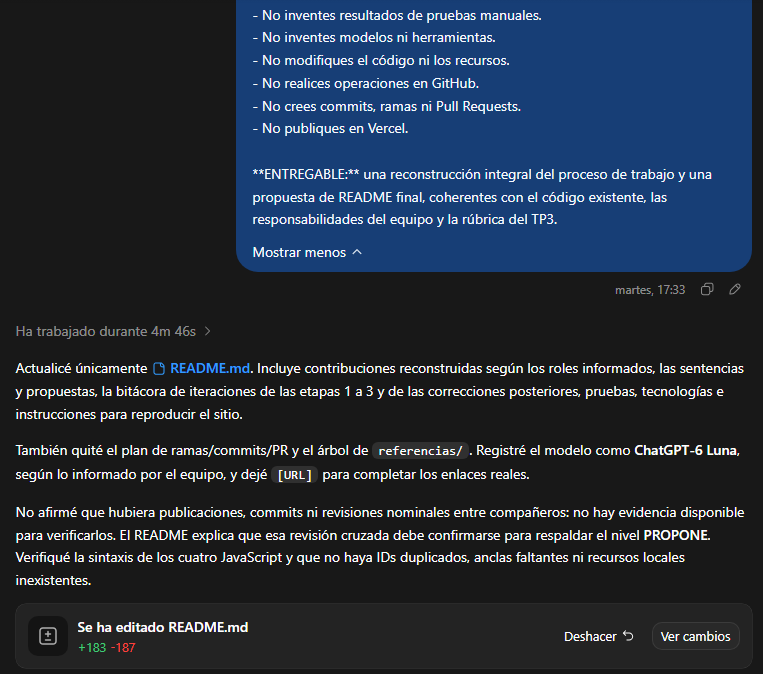

**Descripción:** instrucción de documentación con restricciones explícitas (no inventar pruebas, modelos ni operaciones en GitHub o Vercel). El agente actualizó únicamente `README.md` y declaró qué no pudo verificar. Muestra el uso de IA como apoyo para estructurar y comunicar el trabajo, con supervisión del equipo.

**Criterio de selección de las evidencias:** cada captura muestra una interacción real con la instrucción proporcionada, la respuesta de la IA y los archivos o resultados relacionados con la mejora.

## Uso de inteligencia artificial

La IA se utilizó como herramienta de programación y asistencia durante la construcción de la landing. El equipo dirigió el proceso mediante instrucciones, revisó los resultados, identificó problemas y solicitó correcciones. La responsabilidad sobre las decisiones de diseño, la lógica de las propuestas y la aceptación de los cambios permaneció en el equipo.

| Aplicación utilizada | Modelo utilizado | Uso |
|---|---|---|
| **Codex** | **GPT-6 Luna** (nivel de razonamiento «Medio»), tal como figura en el selector de la aplicación | Generación y modificación de HTML, CSS, JavaScript y SVG; implementación de interacciones; ajustes de diagramas, accesibilidad y responsive; revisión y actualización de documentación a partir de instrucciones del equipo. |
| **Google AI Studio** | **Gemini 3.1 Flash Image (Nano Banana 2)**, plan gratuito, según `docs/IA-PROMPTS.md` | Generación, en el TP1, del logo de EXIMIA CODE y de los avatares del equipo, que se reutilizaron en esta landing. No se generaron recursos nuevos con esta herramienta para el TP3. |

**Diferencia entre aplicación y modelo:** Codex es la aplicación/agente utilizada para trabajar sobre el proyecto. «GPT-6 Luna» es el modelo que figura en el selector de Codex en la captura `proceso/01-codex-modelo-gpt-6-luna.png`.

- **Límite:** la IA ayudó a construir la web; los agentes de NEXO descritos en la landing son conceptuales y no están implementados como sistemas de IA funcionales.

- **Recursos visuales reutilizados:** el logotipo de EXIMIA CODE y los avatares del equipo se generaron previamente, durante el desarrollo de TP1, mediante Google AI Studio. En TP3 se reutilizaron esos archivos, sin generar nuevas imágenes con dicha herramienta. El logo original de NEXO fue proporcionado como parte de la asignación y no fue generado con IA para este trabajo.

- **Prompts visuales de TP1:** están documentados en [`docs/IA-PROMPTS.md`](docs/IA-PROMPTS.md). El archivo se conserva como registro de la procedencia de los recursos reutilizados y no implica que se hayan generado imágenes nuevas para TP3.

### Uso y supervisión humana

El equipo utilizó Codex para:

- Crear y organizar la estructura inicial de la landing.
- Construir las secciones de presentación, las propuestas y los diagramas SVG.
- Implementar los controladores de los recorridos R1 y R2.
- Ajustar conectores, nodos, etiquetas, leyendas y estados visuales.
- Incorporar los casos límite y las decisiones de diseño del grupo.
- Mejorar la navegación, la accesibilidad y la presentación responsive.
- Preparar la documentación y organizar la evidencia de la entrega.

El equipo revisó la correspondencia entre las sentencias y los flujos, la orientación de las ramas, los resultados de las decisiones, la legibilidad de los diagramas y el funcionamiento de los controles. Los cambios se solicitaron de forma iterativa y se comprobaron antes de integrarlos.

La IA se utilizó para construir el sitio; **no se incorporó un modelo de IA dentro de la landing**. Los agentes de NEXO descriptos en R1 y R2 son propuestas conceptuales, no funcionalidades ejecutables.

## Bitácora de iteraciones con IA

La siguiente tabla resume el ciclo de trabajo: instrucción inicial, problema detectado, pedido de mejora y cambio incorporado. Las descripciones sintetizan las instrucciones y revisiones realizadas durante el desarrollo.

| Iteración | Instrucción inicial | Problema detectado por el equipo | Pedido de mejora | Cambio incorporado y motivo |
|---|---|---|---|---|
| **1 · Estructura base** | Crear la estructura de la landing, la navegación, la presentación de NEXO y la identidad de EXIMIA CODE. | Era necesario diferenciar claramente a la startup destinataria del equipo desarrollador y respetar los logotipos originales. | Separar los recursos de marca y organizar el contenido por secciones. | Se incorporaron los logotipos por separado y una estructura base para presentar la startup y las propuestas. |
| **2 · Propuestas R1 y R2** | Desarrollar una propuesta para cada sentencia asignada. | Existía el riesgo de mezclar las condiciones de R1 con las de R2 o modificar la conjunción de la segunda sentencia. | Mantener las sentencias literalmente y diferenciar las decisiones añadidas por el grupo. | Se separaron los flujos y se conservó el alcance lógico de cada sentencia. |
| **3 · Interacción R1** | Crear el diagrama SVG y sus controles de recorrido. | El flujo debía contemplar información incompleta y búsqueda sin coincidencias. | Agregar las ramas de datos faltantes y ausencia de profesionales, identificando las decisiones agregadas. | R1 incorporó solicitud de información y revisión humana como decisiones de diseño, además de la salida con resultados. |
| **4 · Interacción R2** | Representar la evaluación de las cuatro condiciones y sus respuestas. | Debía quedar claro que una sola condición negativa impide la elegibilidad. | Expresar las cuatro condiciones como conjunción y agregar escenarios de prueba. | R2 conserva la lógica AND y presenta como elegible únicamente el caso de cuatro respuestas Sí. |
| **5 · Datos dudosos en R2** | Incorporar una comprobación de datos ausentes, desactualizados o dudosos. | La orientación de algunas etiquetas Sí/No podía confundir la interpretación y faltaba explicar la revisión humana. | Corregir rótulos y conectores; agregar actualización, confirmación/corrección humana y retorno a evaluación. | Se incorporó el recorrido de revisión sin alterar las cuatro condiciones de la sentencia. |
| **6 · Contraste y conectores** | Revisar la presentación de los nodos y la conexión entre ramas. | Se detectaron contrastes insuficientes, flechas superpuestas y etiquetas desplazadas. | Ajustar colores, uniones, conectores, posiciones y espaciado. | Se mejoró la legibilidad de los diagramas y se reemplazaron flechas superpuestas por puntos de unión y una salida clara. |
| **7 · Leyendas y casos de prueba** | Explicar el significado de las formas y los colores y documentar excepciones. | La lectura aislada de los diagramas podía dificultar la distinción entre sentencia y decisiones del grupo. | Añadir leyendas y tablas accesibles de casos de prueba. | Se incorporaron referencias visuales y explicaciones textuales para los pasos, decisiones y casos límite. |
| **8 · Accesibilidad y responsive** | Mejorar la navegación por teclado y adaptar los diagramas a pantallas angostas. | Los diagramas extensos necesitaban una alternativa de lectura vertical y controles claros para consultar la vista completa. | Añadir recorrido vertical, alternancia independiente, foco visible, contraste y etiquetas más claras. | Se incorporó la vista vertical en pantallas angostas y la alternancia con el SVG completo, conservando los controladores y la lógica de los flujos. |
| **9 · Revisión de integración** | Revisar la landing integrada y los cambios de cada rama antes de incorporarlos a `main`. | Era necesario verificar que las mejoras visuales y los casos de prueba no alteraran las sentencias ni el comportamiento de los recorridos. | Revisar cada Pull Request desde otra responsabilidad del equipo y corregir observaciones antes de integrar. | Se realizaron revisiones cruzadas y se integraron los cambios aprobados mediante Pull Requests. |
| **10 · Documentación y evidencias** | Preparar el README final, las capturas y los enlaces de entrega. | La documentación debía coincidir con el proyecto publicado, identificar las herramientas y modelos y explicar el proceso de construcción. | Organizar el índice, las responsabilidades, la estructura real, las pruebas, la bitácora y las capturas con nombres definidos. | Se consolidó este README con enlaces, estructura, pruebas, declaración de IA y espacios de capturas identificados y descriptos. |

## Colaboración, revisión cruzada y Pull Requests

El trabajo se organizó mediante ramas por responsabilidad y Pull Requests revisados por otros integrantes. Los seis PR fueron aprobados e incorporados a `main`, lo que permitió realizar controles cruzados antes de integrar los cambios a la versión compartida del proyecto.

| PR | Tema | Integrante que realizó los cambios | Revisión cruzada | Estado |
|---|---|---|---|---|
| **#1** | Estructura base de la landing NEXO | Fiorella Alarcón | Selene Pais | Aprobado e integrado en `main`. |
| **#2** | Decisiones del grupo y casos de prueba de R1 | Axel Alva | Javier Churquina | Aprobado e integrado en `main`. |
| **#3** | Uniones del diagrama y casos de prueba de R2 | Javier Churquina (`@Freddy1537`) | Axel Alva | Aprobado e integrado en `main`. |
| **#4** | Legibilidad, accesibilidad y visualización de diagramas | Malena Jasque | Fiorella Alarcón | Aprobado e integrado en `main`. |
| **#5** | Sección Equipo y ficha técnica de construcción agéntica | Fiorella Alarcón | Malena Jasque | Aprobado e integrado en `main`. |
| **#6** | README, capturas, evidencias y enlaces de entrega | Selene Pais | Malena Jasque | Aprobado e integrado en `main`. |

### Mejoras concretas surgidas de las revisiones

- **Selene revisó el PR #1 de Fiorella:** comprobó la estructura inicial, la organización de archivos y las rutas de los recursos, contribuyendo a establecer una base ordenada para el desarrollo posterior.
- **Javier revisó el PR #2 de Axel (R1):** verificó que los datos faltantes y la ausencia de coincidencias tuvieran recorridos diferenciados y que R1 no incorporara condiciones de disponibilidad ni verificación.
- **Axel revisó el PR #3 de Javier (R2):** observó que los puntos de unión debían mostrar la continuidad del recorrido sin superposición de flechas y que el caso de datos dudosos debía pasar por intervención humana antes de reevaluar. La observación orientó la comprobación de que se conservaran las cuatro condiciones y su conjunción.
- **Fiorella revisó el PR #4 de Malena:** comprobó la alternancia de vistas, los tres recorridos de R1, las 16 combinaciones de R2, la navegación por teclado y la visualización en 1440, 768 y 390 px. La revisión permitió integrar los ajustes de visualización y accesibilidad.
- **Malena revisó el PR #5 de Fiorella:** verificó la correspondencia de las cinco personas, sus imágenes, roles y responsabilidades. También comprobó que la ficha técnica diferenciara la construcción agéntica de la landing de las propuestas conceptuales de solución de NEXO.
- **Malena revisó el PR #6 de Selene:** contrastó el README con la versión final del proyecto y verificó las capturas, las evidencias y los enlaces de entrega, contribuyendo a que la documentación representara correctamente el producto publicado.

Las tarjetas de la sección [Equipo](https://tp3-grupo-12.vercel.app/#equipo) resumen las responsabilidades y las contribuciones del grupo. En conjunto, la revisión cruzada permitió mejorar y verificar distintos aspectos del proyecto desde la perspectiva de otros integrantes: lógica de las propuestas, representación de los diagramas, accesibilidad, organización del equipo y documentación final.

## Checklist de verificación

### Consigna: contenido y lógica

- [x] Se identificó la startup (NEXO) y el bloque (S11-A) del equipo.
- [x] Se incluyen las dos sentencias con su redacción original y una propuesta para cada una.
- [x] Los dos flujos respetan las condiciones originales: R1 es servicio ∧ ubicación y R2 es servicio ∧ zona ∧ disponibilidad ∧ verificación.
- [x] Se entienden las decisiones, acciones y resultados de cada recorrido.
- [x] Los pasos agregados por el grupo están marcados como decisión del grupo.
- [x] Cada propuesta indica qué haría el futuro agente, qué registro consultaría y cuándo pediría ayuda a una persona.

### Consigna: diseño y funcionamiento

- [x] El logo original de NEXO y los dos diagramas se ven completos y legibles en desktop.
- [x] Los desplegables se abren y cierran con clic y con teclado.
- [x] La página se lee y recorre en desktop sin desbordes.
- [x] Se recorrió un caso que cumple y otro que no para cada flujo.
- [x] Otra persona puede explicar la propuesta después de recorrerla.

### Entrega y documentación

- [x] Repositorio y landing publicados y accesibles desde una ventana sin sesión.
- [x] El README incluye los dos enlaces, los integrantes con sus aportes y las herramientas de IA con su modelo.
- [x] Aplicaciones y modelos declarados tal como los informa cada herramienta: Codex con el modelo GPT-6 Luna, y Google AI Studio con Gemini 3.1 Flash Image (solo para los recursos visuales reutilizados del TP1).
- [x] No se editó el código a mano: cada cambio se pidió al agente y se revisó.
- [x] La landing no incorpora IA, APIs ni backend.
- [x] Las 14 capturas (PNG y JPEG) están en `docs/capturas/interfaz/` y `docs/capturas/proceso/` y corresponden a la versión final.
- [x] Los seis Pull Requests fueron revisados por otro integrante e integrados en `main`.
- [x] La versión publicada en Vercel corresponde al último commit de `main`.

## Relación con la rúbrica — nivel PROPONE

La siguiente síntesis relaciona los aspectos de la entrega con los criterios de evaluación de la consigna.

| Criterio | Evidencia incorporada | Aporte al nivel PROPONE |
|---|---|---|
| **1. Participación y colaboración** | Cinco integrantes identificados, responsabilidades diferenciadas, ramas de trabajo, seis Pull Requests y revisiones cruzadas. | Se documenta la participación del equipo y las mejoras concretas que surgieron de revisar el trabajo de otros integrantes. |
| **2. Repositorio y landing accesibles** | Repositorio GitHub y landing Vercel públicos, enlaces en el README, instrucciones para reproducir el proyecto, comprobación fechada de los enlaces y del funcionamiento y checklist de verificación. | La entrega puede consultarse sin iniciar sesión y la documentación permite conocer cómo abrir la landing. |
| **3. Organización y navegación de la landing** | Presentación de NEXO, identificación del equipo, dos propuestas separadas, diagramas interactivos, leyendas y desplegables. | La organización permite comprender el objetivo y recorrer cada propuesta sin confundir sus condiciones. |
| **4. Casos límite e intervención humana** | R1 contempla datos faltantes y ausencia de coincidencias; R2 contempla condiciones negativas y datos dudosos con actualización y revisión humana. | Cada flujo explica sus excepciones y cómo se resuelven, diferenciando las decisiones del grupo de las sentencias originales. |
| **5. Uso de IA e iteración** | Aplicaciones Codex (GPT-6 Luna), captura de una interacción, bitácora de instrucciones, problemas, pedidos y cambios. | Se evidencia un proceso iterativo dirigido y revisado por el equipo, con identificación diferenciada de aplicación y modelo. |

La documentación, los diagramas, las pruebas y las revisiones se presentan como evidencia del trabajo realizado por el Grupo 12. La autoría del resultado corresponde al equipo: la IA asistió en la construcción, mientras que las decisiones sobre el alcance, la lógica de las propuestas, las correcciones y la integración fueron revisadas por sus integrantes.
